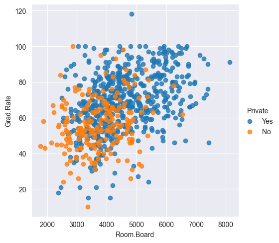
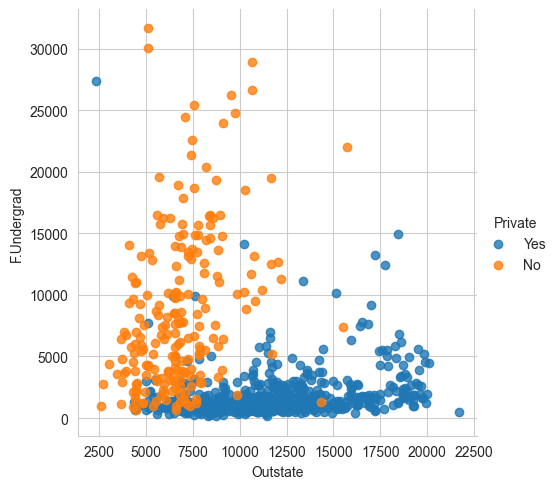
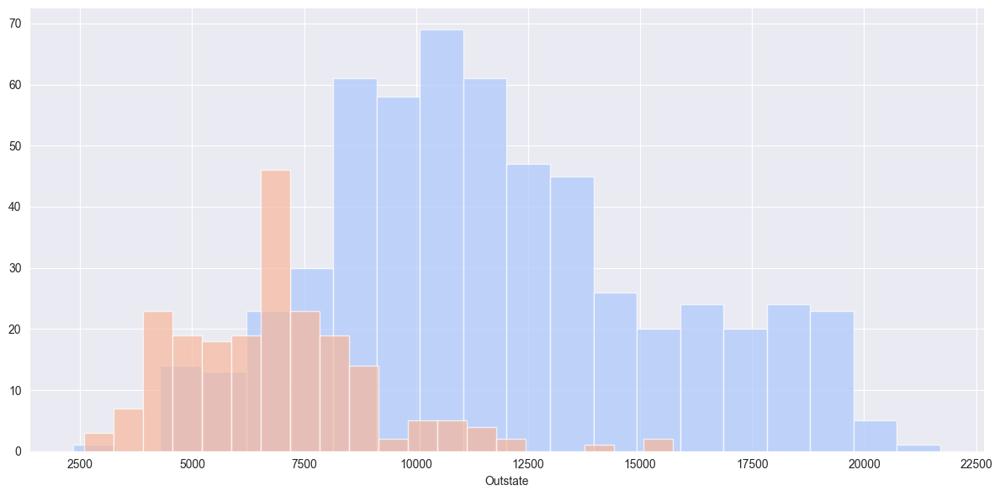
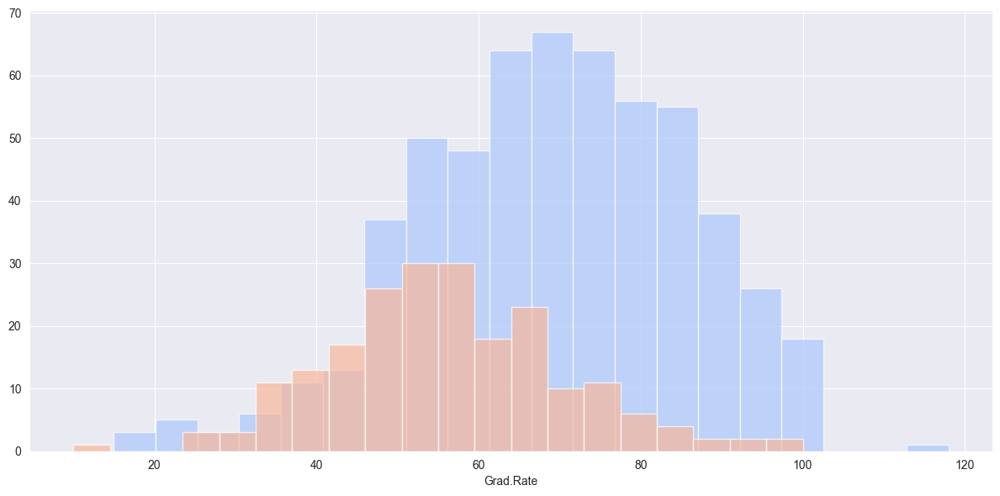

# K-Means Clustering Project

## 📌 Overview
This project applies **K-Means Clustering** to classify universities into two groups: **Private** and **Public**. Since K-Means is an **unsupervised learning algorithm**, the actual labels are not used during training, but they are available for evaluation purposes.

## 📂 Project Structure
```
├── data/                  # Dataset used for clustering
├── notebooks/             # Jupyter notebooks with step-by-step implementations
├── src/                   # Python scripts for clustering
├── results/               # Outputs, cluster labels, and evaluation metrics
├── visualizations/        # Plots and graphical representations
├── README.md              # Project documentation
└── requirements.txt       # Dependencies required to run the project
```

## 📊 Dataset
The dataset contains **777 observations** with the following **18 features**:

- **Private**: Whether the university is private (Yes) or public (No)
- **Apps**: Number of applications received
- **Accept**: Number of applications accepted
- **Enroll**: Number of new students enrolled
- **Top10perc**: Percentage of new students from the top 10% of their high school class
- **Top25perc**: Percentage of new students from the top 25% of their high school class
- **F.Undergrad**: Number of full-time undergraduates
- **P.Undergrad**: Number of part-time undergraduates
- **Outstate**: Out-of-state tuition cost
- **Room.Board**: Room and board costs
- **Books**: Estimated book costs
- **Personal**: Estimated personal expenses
- **PhD**: Percentage of faculty with PhDs
- **Terminal**: Percentage of faculty with terminal degrees
- **S.F.Ratio**: Student-to-faculty ratio
- **perc.alumni**: Percentage of alumni who donate
- **Expend**: Instructional expenditure per student
- **Grad.Rate**: Graduation rate

## 🚀 Installation
### 1️⃣ Clone the repository:
```bash
git clone https://github.com/heet8/K-Means-Cluster-Project.git
cd K-Means-Cluster-Project
```

### 2️⃣ Install dependencies:
```bash
pip install -r requirements.txt
```

## 🔍 Methodology
### 1. **Data Preprocessing**
- **Handling Missing Values**: Checked and handled missing data if any.
- **Feature Scaling**: Standardized numerical features to ensure optimal clustering.

### 2. **Exploratory Data Analysis (EDA)**
- **Distribution of Variables**: Analyzed distributions using histograms and boxplots.
- **Correlation Analysis**: Examined relationships between features.
- **Pairplots**: Visualized feature interactions.

### 3. **K-Means Clustering**
- **Choosing the Number of Clusters (K)**: Used the **Elbow Method** and **Silhouette Score** to determine the optimal `k` value.
- **Fitting the Model**: Applied `KMeans` from Scikit-learn to group universities.

### 4. **Model Evaluation**
- **Comparison with Actual Labels**: Compared cluster assignments to actual **Private/Public** labels.
- **Confusion Matrix & Classification Report**: Assessed clustering performance.

## 📊 Visualizations
All plots and visualizations are stored in the `visualizations/` folder. Some key plots include:
- **A scatterplot of Grad.Rate versus Room.Board where the points are colored by the Private column**: 
- **A scatterplot of F.Undergrad versus Outstate where the points are colored by the Private column**: 
- **a stacked histogram showing Out of State Tuition based on the Private column**: 
- **A similar histogram for the Grad.Rate column**: 
  
## 🛠️ Technologies Used
- **Python**
- **Scikit-learn**
- **Pandas & NumPy**
- **Matplotlib & Seaborn**
- **Jupyter Notebook**

## 📌 Future Improvements
- **Try Different Clustering Algorithms**: Compare results with **Hierarchical Clustering** and **DBSCAN**.
- **Feature Engineering**: Create new features for better clustering.
- **Dimensionality Reduction**: Apply **PCA** for improved visualization.

